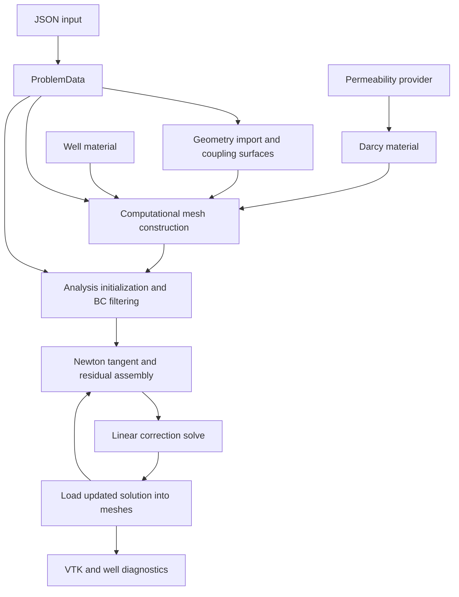

# C++ architecture

The coupled model contains a three-dimensional reservoir, one-dimensional well
lines, and surface elements that connect reservoir normal flux to well pressure.
The Darcy materials also expose dimension settings for standalone problems;
this does not make the entire coupled geometry pipeline dimension-independent.

## Responsibilities

| Class | Role | Main collaborators |
|---|---|---|
| `ProblemData` | Read JSON; store domains, wells, fluids, boundaries, numerical and output options; derive IDs and scale data | All builders, analysis, exporters |
| `TPZWannGeometryTools` | Import Gmsh geometry; create coupling surfaces; order well node IDs; provide refinement helpers | `ProblemData`, NeoPZ geometry |
| `TPZWannApproxTools` | Build mixed or H1 computational spaces, materials, connects, and interfaces | Geometry tools, reservoir/well materials |
| `TPZAnisotropicPermeability` | Supply constant or spatial permeability and its inverse as global 3 × 3 tensors | Both Darcy formulations |
| `TPZAnisotropicPermeabilityBC` | Empty compatibility interface required by the NeoPZ boundary-material mechanism | Permeability-bearing material base |
| `TPZDarcyAnisotropic` | Linear pressure-only Darcy stiffness and load assembly | Permeability provider |
| `TPZMixedDarcyAnisotropic` | Linear mixed flux/pressure Darcy assembly | Permeability provider |
| `TPZWannDarcyNL` | Pressure-only Darcy tangent and negative residual for a coupled Newton solve | Linear H1 Darcy base, analysis |
| `TPZWannMixedDarcyNL` | Mixed Darcy tangent and negative residual for a coupled Newton solve | Linear mixed Darcy base, analysis |
| `TPZWannH1Well` | Pressure-based well law with laminar/turbulent friction and optional pseudo-resistivity | H1 mesh builder, analysis |
| `TPZWannMixedWell` | Axial flow/pressure well law with laminar/turbulent friction and optional dual functional | Mixed mesh builder, analysis |
| `TPZWannAnalysis` | Initialize/filter essential boundary equations; run Newton updates and diagnostics | Computational mesh, `ProblemData`, well flags |
| `TPZWannPostProcTools` | Export VTK, integrate reservoir flux into well segments, calculate productivity | Solved meshes, material outputs |
| `TPZWannAdaptivityTools` | Historical error estimation, marking, compatibility, and refinement experiments | Old configuration API; outside the current library build |

## Typical flow

NeoPZ calls material methods at integration points. Materials operate on supplied
shape functions and solution data; they do not create the finite-element spaces.
The builders create those spaces and connect their unknowns. The analysis controls
assembly and solution updates, rather than defining physical constitutive laws.

## Material families

The linear Darcy classes form element stiffness/load contributions without needing
the current numerical solution for their volume assembly. Their `NL` subclasses
form a tangent and a right-hand side equal to the negative current residual. The
current reservoir law itself is linear for a fixed spatial permeability. The well
friction supplies the nonlinear behavior in the coupled model.

The well materials have their own physical coefficients and do not inherit the
permeability provider. The H1 well eliminates flow in favor of a pressure derivative;
the mixed well solves for flow and pressure independently.

The mixed builder creates atomic meshes with flux in position zero and pressure
in position one, then a multiphysics mesh and coupling interfaces. Additional
spaces may be supplied by NeoPZ's approximation creator; their historical output
names should not be confused with the two primary physical spaces.

## Lifetimes and shared state

Geometry and computational factories allocate meshes and return raw pointers.
The caller must arrange their lifetime, including keeping the geometry available
while its computational meshes exist. Materials inserted into a mesh are managed
through the NeoPZ mesh infrastructure.

`TPZWannAnalysis::SetProblemData()` borrows a pointer. The simulation data must
remain valid through initialization, solving, and post-processing. Permeability
callbacks are copied, but references captured by those callbacks remain the
caller's lifetime responsibility.

Both well classes expose static first-iteration and residual-only flags. Those
flags affect all instances of their respective class; they are not per-well or
per-analysis state. This matters for diagnostics, line searches, and concurrent
independent analyses.

## Build boundaries

The root CMake file creates `WANN_lib` and links it to `NeoPZ::pz`. `src/CMakeLists.txt`
collects source files directly in `src/`; its glob is not recursive. Consequently,
`src/needRefactor/TPZWannAdaptivityTools.cpp` is not compiled into that library.
The bundled JSON header is included by configuration parsing; it is not a WANN
class to maintain or document locally. `dirs_config.h` is generated from
`dirs_config.h.in` during configuration.

Some executable files still refer to removed configuration fields or renamed
builders. See [legacy status](legacy.md) before choosing a driver. An executable
listed by CMake is not, by itself, evidence that its source matches the current API.
